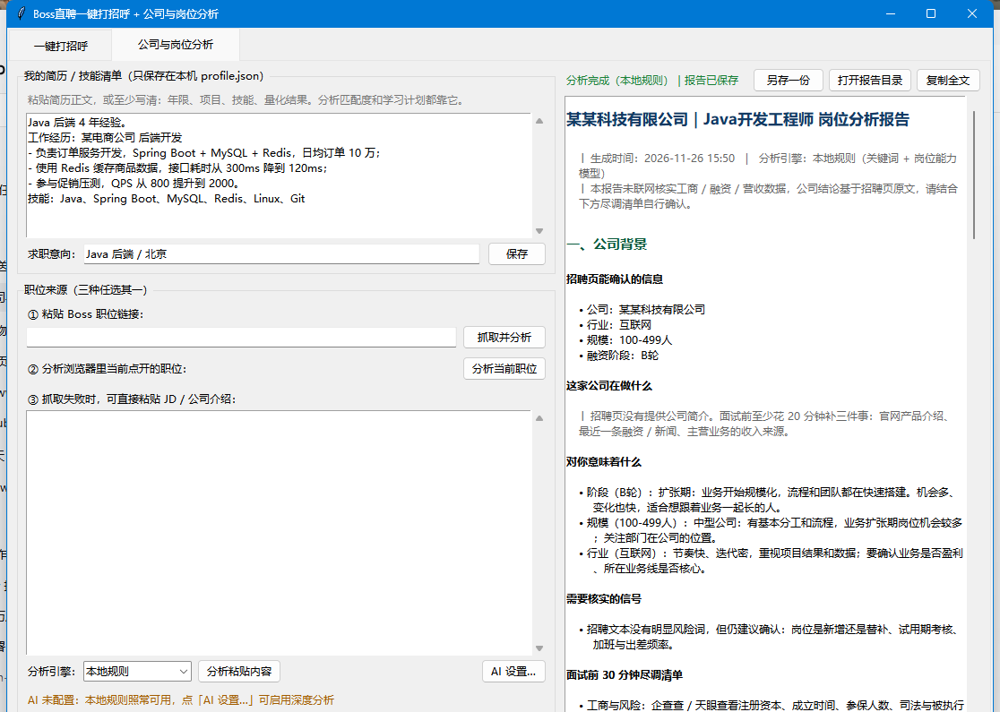

# Boss 直聘一键打招呼 + 公司与岗位分析

Windows 桌面小工具：在 Boss 直聘网页版上批量打招呼，支持城市多选、按关键词/行业筛选，并能在发送前或手动分析目标公司与岗位，生成简历修改建议和技能学习计划。



> ⚠️ **免责声明**
>
> - 本项目与 Boss 直聘官方无关，仅用于个人求职效率与学习交流。
> - 自动化操作可能违反平台用户协议，存在账号被限制、封禁等风险；请自行评估并承担后果。
> - 请控制发送频率和数量，不要用于骚扰、营销、批量骚扰或任何违法用途。
> - 分析报告由规则/大模型生成，可能存在错误，请自行核实，不要当作公司或岗位的权威信息。

## 功能

- **一键打招呼**：自动扫描职位列表，逐个点击「立即沟通」，可设置发送上限与随机间隔。
- **筛选**：职位关键词、城市（多选，按顺序逐城搜索、额度均分）、公司行业。
- **补发介绍**：平台招呼语发送后，可再补一条自定义介绍。
- **公司背景分析**：行业、规模、融资阶段、成立时间、注册资本、参保人数、公司简介，以及阶段/规模/行业解读、风险信号和尽调清单。
- **岗位分析 + 简历建议**：拆解 JD 的职责/要求/技能关键词，给出岗位画像、匹配度、简历修改清单和可直接套用的 bullet 模板。
- **技能学习计划**：按 P0/P1 优先级和 30/60/90 天节奏，告诉你该补什么、怎么验收。
- **双分析引擎**：本地规则（不联网、免费）或任意 OpenAI 兼容接口（默认 DeepSeek）；AI 失败会自动降级为本地报告。
- **发送前自动分析**：每打招呼一个职位前生成一份分析，汇总到 `reports/批次_时间.md`。

## 快速开始

### 环境

- Windows 10 / 11
- Python 3.8+（开发环境为 3.14）
- Chrome 或 Edge（工具会用独立配置目录启动浏览器）

### 安装与运行

```bash
git clone https://github.com/wujaiwei-cmd/boss-zhipin-assistant.git
cd boss-zhipin-assistant
pip install -r requirements.txt
python boss_auto.py
```

也可以直接下载 ZIP 解压后双击 `启动.bat`。

首次使用：

1. 点「打开网页版」，在工具打开的浏览器里扫码登录 Boss 直聘（登录态会保存在本机 `boss_profile/`）。
2. 在「一键打招呼」页设置关键词、城市（可多选）、行业、发送上限和间隔。
3. 点「开始发送」。
4. 想分析职位时，切到「公司与岗位分析」页，粘贴简历 → 粘贴职位链接（或分析当前点开的职位）→ 看报告。

### AI 分析（可选）

打开「公司与岗位分析」→「AI 设置…」，默认接 DeepSeek：

- Base URL：`https://api.deepseek.com/v1`
- 模型：`deepseek-chat`
- API Key：填自己的

任何 OpenAI 兼容接口都可以用（通义、Kimi、智谱、本地 Ollama 等），改 Base URL 和模型名即可。Key 只保存在本机 `config.json`，不会被上传。

## 数据与隐私

以下文件包含个人数据，已在 `.gitignore` 中排除，**不要提交到仓库**：

| 文件/目录 | 内容 |
|---|---|
| `boss_profile/` | 工具浏览器的登录态 / Cookie |
| `config.json` | AI API Key 等配置 |
| `profile.json` | 你的简历与求职意向 |
| `reports/` | 本地生成的分析报告 |
| `error.log` | 运行日志（可能含本地路径） |

## 项目结构

```
boss_auto.py      主程序：界面、发送流程、页面抓取
job_analysis.py   分析引擎：JD/公司解析、匹配、报告、AI 调用
job_kb.py         知识库：技能、岗位能力模型、行业/风险信号
使用说明.md        详细使用文档
docs/             README 截图
requirements.txt  Python 依赖
启动.bat          Windows 启动脚本
```

## 使用文档

更详细的配置、报告说明和常见问题见 [使用说明.md](使用说明.md)。

## License

[MIT](LICENSE)
